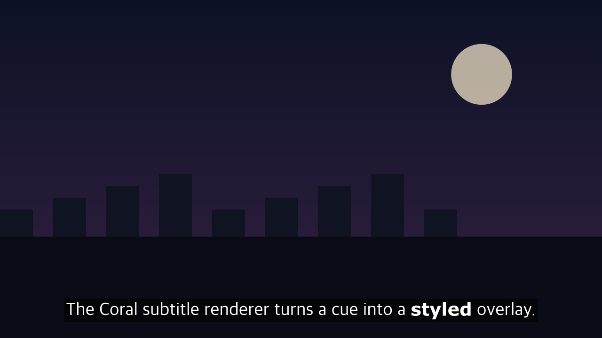

# CoralSubtitle

The subtitle rendering framework. It is the layer between the extractor's cue model and the Graphics
Canvas: it takes an `AVCueGroup` — the cues that are shown at one moment — lays the text out, and
rasterises it into an RGBA overlay that a composition renderer or a player blends over the picture.

It is the counterpart of the platform players' subtitle painters, built on this repository's Canvas
instead of a platform text stack: the lines of every cue are wrapped and laid out at the bottom of the
frame (or where the cue says) and drawn with the colour, the window, the ruby annotations and the
weights the cue and the `SubtitleStyle` declare. Bitmap subtitles (PGS, VobSub, DVB, TTML images) are
drawn as pictures.

CoralSubtitle depends on CoralCore (`utils`, `minilog`), CoralMedia (`extractor`, which owns `AVCue`,
`AVCueGroup` and the subtitle parsers) and CoralGraphics (`graphics`, which owns the Canvas, the
Bitmaps and the font stack). CoralCompose and CoralPlayback depend on CoralSubtitle; it does not depend
on Playback, Compose or UI.

## Layout

```
include/subtitle/       public headers, the API a client includes (<subtitle/...>)
src/
  SubtitleRenderer.cpp  the public renderer: font selection, cue measurement, the image cache
  CueLayout.cpp         resolves the cue text size, colours and ruby runs, and wraps each cue
  HorizontalTextLayout.cpp  hard line breaks and word/character wrapping
  VerticalTextLayout.cpp    fits the columns of vertical text into the viewport
  TextLayout.cpp            the direction-neutral wrapper the renderer calls
  SubtitlePainter.cpp       the helpers shared by both cue painters (colours, spans, outlines)
  HorizontalCuePainter.cpp  draws one horizontal cue, including ruby and emphasis marks
  VerticalCuePainter.cpp    draws one vertical cue and its ruby columns
  SubtitleResources.cpp     decodes the pattern image an SDF style may point at
  Utf8.h                    the grapheme-cluster walk every layout shares
tests/                  the unit suite of the renderer and the layout helpers
examples/               the standalone demo project (not built by a consumer)
  platform/mac/         the Cocoa window the macOS demo presents its frame in
scripts/                the bootstrap tools that fetch the dependency repositories
docs/                   the frame the README embeds
third_party/            libz, libyuv and libgtest, fetched by the bootstrap tool
external/               CoralCore, CoralMedia and CoralGraphics, fetched by the bootstrap tool
```

The repository is a single module and builds that module directly from the root `CMakeLists.txt`;
there is no `modules/` directory and no shared `cmake/` wrapper to include. That is the same layout
CoralAudio uses.

## How one frame is rendered

1. A parser from `extractor` turns a subtitle document or a sample into `AVCue` values, and the
   player groups the cues that are shown together into an `AVCueGroup`.
2. `SubtitleRenderer::paint()` resolves the font family and size (`FontManager`, the style and the
   cue-level text size), draws the bitmap cues that carry their own pixels, and measures the text
   cues through `measureCues()`.
3. `measureCues()` wraps each cue to the frame width, collects its ruby runs, applies the paragraph
   indent and the WebVTT region line limit, and reports the cue-level colour and line height.
4. `paintHorizontalCue()` / `paintVerticalCue()` draw the window, the background spans, the black
   outline and the fill, the emphasis marks and the underline at the position the cue declares.
5. The result is an image whose pixels are blended over the composed frame. `render()` returns that
   image from a cache: an unchanged group at the same size with the same style returns the previous
   frame's image, so a still subtitle costs no rasterisation. The cache is bounded (32 MB) so a 4K
   player does not hold several full frames for a subtitle that is mostly transparent.

The default look is the one a player draws when the style says nothing: white text at 5.33% of the
frame height, a 4% horizontal margin, a 5% bottom margin and a 2 px black outline. `SubtitleStyle`
overrides the colour, the family, the weight, the alignment and the SDF outline/shadow/pattern;
`TextDisplayOptions` adds the window behind the text and changes the margins.

## Building

Requirements: Git, CMake 3.19 or newer and a C++20 compiler.

* **macOS**: the Xcode Command Line Tools (`xcode-select --install`). Ninja is optional; the generated
  makefiles work without it. CoralGraphics builds with Metal as its backend.
* **Windows**: Visual Studio 2022 with the *Desktop development with C++* workload.
* **Linux**: a C++20 compiler, Ninja, and the X11/OpenGL development packages CoralGraphics needs for
  its backend and window demos.

CoralSubtitle is a standalone CMake project. Its dependency repositories are declared in
`.gitmodules` but are not part of this checkout, so fetch them first with the bootstrap tool for the
host:

macOS / Linux:

```sh
./scripts/bootstrap.sh
```

Windows PowerShell:

```powershell
.\scripts\bootstrap.ps1
```

If the PowerShell execution policy blocks local scripts, run it through
`powershell -ExecutionPolicy Bypass -File .\scripts\bootstrap.ps1`.

The tool reads `.gitmodules` and, for every entry, clones the repository from its default remote
branch into the declared path. An existing checkout is updated with a fast-forward pull, and a
detached submodule checkout is switched back to the remote default branch. Nested repositories are
initialized too (Minilog for CoralCore, GoogleTest for libgtest, and CoralGraphics' own third-party
tree). The tool is idempotent: rerunning it updates what is already there and stops with an error
instead of discarding local changes.

Because the checkouts follow the remote branches rather than commits recorded by this repository,
`git status` would report them as untracked; the dependency paths are therefore listed in
`.gitignore` and never become part of a commit.

The repositories it manages are:

| Path | Contents |
| --- | --- |
| `external/CoralCore` | `utils`, `core`, `event` and Minilog |
| `external/CoralMedia` | codec, media and the extractor cue model + subtitle parsers |
| `external/CoralGraphics` | Canvas, font stack, image codecs and the GPU backend |
| `third_party/libz` | zlib, used by the extractor's compressed subtitles and the PNG codec |
| `third_party/libgtest` | GoogleTest for the test suite |
| `third_party/libyuv` | only needed with `-DCORAL_SUPPORTS_FFMPEG=ON` |

The standalone build is three steps:

```sh
# 1. Configure the project
cmake -S . -B build -DCMAKE_BUILD_TYPE=Release

# 2. Build the library, the tests and the demo
cmake --build build -j8

# 3. Run the tests
ctest --test-dir build -R "test_Subtitle|subtitle_render_demo_verify" --output-on-failure
```

A bare `ctest` also lists the vendored libjpeg-turbo and Shaderc tests that CoralGraphics registers;
their command-line executables are not built by this project, so CTest reports them as *Not Run* and
the run exits non-zero. That is why the command above names this repository's two tests, which is the
same scoping the CoralGraphics README uses for its own suite.

```sh
# The demo is built with the project
./build/examples/subtitle_render_demo            # macOS: a Cocoa window
./build/examples/subtitle_render_demo --verify   # headless check, no window
```

On Windows the same commands work from a Developer PowerShell for Visual Studio, or the generated
solution can be opened in Visual Studio or CLion. A multi-configuration generator ignores
`CMAKE_BUILD_TYPE`: build with `cmake --build build --config Release` and pass `-C Release` to CTest.

The CMake target is `subtitle` and the artifact is `coral-subtitle`: the default build produces
`libcoral-subtitle.a`, and `-DBUILD_SHARED_LIBS=ON` produces `libcoral-subtitle.dylib` on macOS,
`libcoral-subtitle.so` on Linux and `coral-subtitle.dll` with an import library on Windows.
`cmake --install` writes the library to `lib/` (the DLL to `bin/`) and the public headers to
`include/subtitle/`, so a client compiles against `<subtitle/...>` with `include/` on its header path.

### macOS notes

* The root `CMakeLists.txt` enables the `OBJCXX` language on Apple *before* it adds the dependencies.
  CoralMedia's codecs and CoralGraphics' frame clock and Metal display link are Objective-C++ files;
  without that line the generate step fails with `Missing variable is: CMAKE_OBJCXX_COMPILE_OBJECT`.
* The library itself has no platform code. The demo links `Cocoa` and `QuartzCore`; the renderer's
  platform frameworks arrive with CoralGraphics.
* CoralGraphics uses `CADisplayLink` for its frame clock, which the SDK declares as available from
  macOS 14. When a deployment target is set, use 14.0 or newer:

  ```sh
  cmake -S . -B build -G "Unix Makefiles" -DCMAKE_BUILD_TYPE=Release \
        -DCMAKE_OSX_DEPLOYMENT_TARGET=14.0
  ```

  A standalone configure warns when a smaller target is named.
* Vulkan is not offered on Apple platforms; CoralGraphics forces its Metal backend on and its Vulkan
  backend off, so no Vulkan loader is needed.
* Ninja works too (`brew install ninja`, then `-G Ninja`), but the Command Line Tools' make is enough.

### Build options

| Option | Default | Meaning |
| --- | --- | --- |
| `BUILD_SHARED_LIBS` | `OFF` | Build `subtitle` as a shared library. The dependencies get `CMAKE_POSITION_INDEPENDENT_CODE`. |
| `CORAL_BUILD_TESTS` | `ON` standalone, `OFF` as a subproject | Build the test suite and register it with CTest. |
| `CORAL_SHARED_THIRD_PARTY_DIR` | auto | Directory that carries the shared `libz`, `libyuv` and `libgtest`. |
| `CORAL_CORE_DIR`, `CORAL_MEDIA_DIR`, `CORAL_GRAPHICS_DIR` | auto | Explicit dependency directories for a parent tree. |

The configure looks for the shared third-party tree in this order, and uses the first candidate that
has `libz/coral/CMakeLists.txt` (zlib is needed by the extractor whether or not the tests are built;
GoogleTest is then taken from the same tree when the suite is enabled):

1. `third_party/` — a standalone checkout (and what the bootstrap tool fills in);
2. `../../third_party` — the application tree, two levels above `frameworks/CoralSubtitle`;
3. `external/CoralGraphics/third_party` and `external/CoralCore/third_party` — the copies the
   dependency submodules carry.

GoogleTest is test-only. A checkout without it still configures and builds the library; the tests are
then disabled with a warning instead of failing the configure.

## Using it from another project

An application that keeps the frameworks side by side adds them in dependency order and then adds
CoralSubtitle:

```cmake
add_subdirectory(CoralCore)
add_subdirectory(CoralMedia)
add_subdirectory(CoralGraphics)
add_subdirectory(CoralSubtitle)

target_link_libraries(my_player PRIVATE subtitle)
```

The consumer includes `<subtitle/SubtitleRenderer.h>` and gets `graphics` and `extractor` through
the target's public link interface. As a subproject, CoralSubtitle does not build its tests or its
demo, and it does not add the dependency repositories: the application supplies those targets. The
`CORAL_*_DIR` options override the automatic lookup when the directories are somewhere else.

## Tests

`tests/test_Subtitle.cpp` covers the layer a consumer sees:

* the default look draws into a transparent overlay at the bottom of the frame;
* an empty group returns no image, and an unchanged group returns the cached image;
* `invalidate()` drops the cache;
* a bitmap cue is drawn without a font;
* the horizontal layout wraps to the requested width and keeps hard line breaks;
* the vertical layout fits its natural columns, scales down when they do not fit, and keeps one column
  for empty text.

The demo's `--verify` mode is the end-to-end check and is registered as a CTest test: it parses the
built-in document, renders the first cue and fails when no subtitle pixel was drawn. Both tests are
run by the scoped `ctest` command in [Building](#building).

## Demo



`examples/subtitle_render_demo.cpp` is the standalone demo; `examples/README.md` documents every
option. In one line:

```sh
./build/examples/subtitle_render_demo --time 4.5 --output frame.png
```

It builds a small SubRip document (or reads one named with `--file`, in SubRip, WebVTT, SSA/ASS,
TTML or TX3G), parses it through the same factory a player uses, prints the cue table, rasterises
the cues that are active at one time, composites the overlay over a synthetic frame and presents the
result in a Cocoa window on macOS (or writes a PNG elsewhere). The image above is the frame the demo
wrote for `docs/subtitle-demo-frame.png`.

## License

Apache License 2.0. See [LICENSE](LICENSE).
